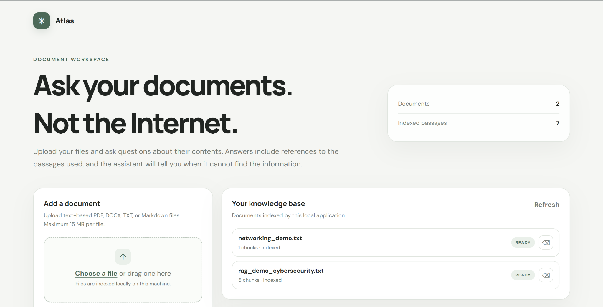
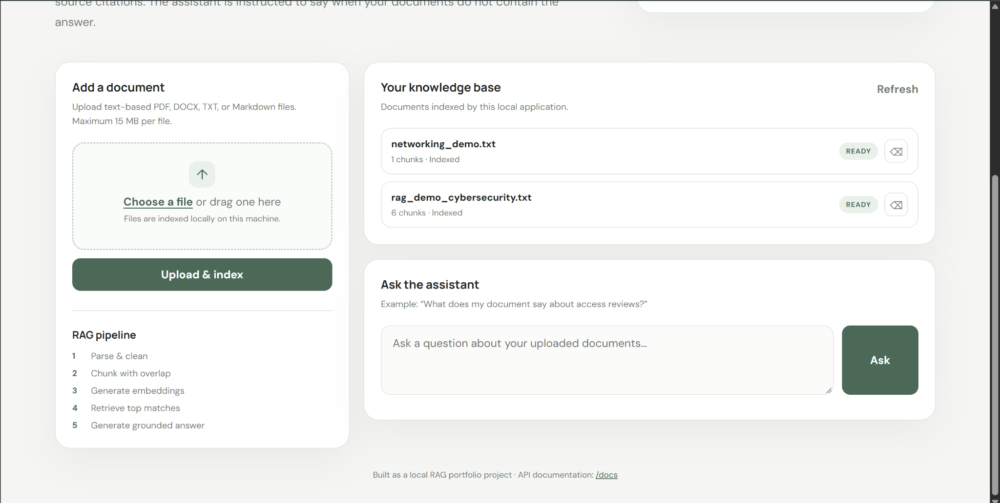
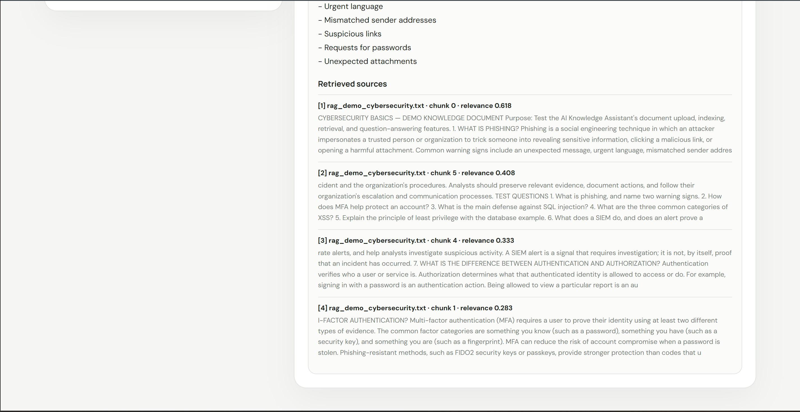
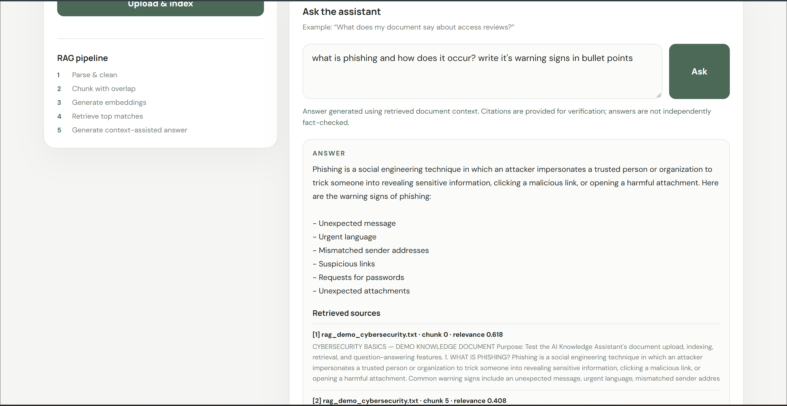
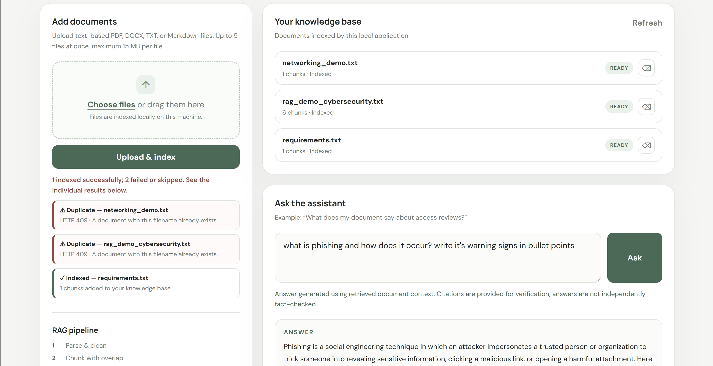
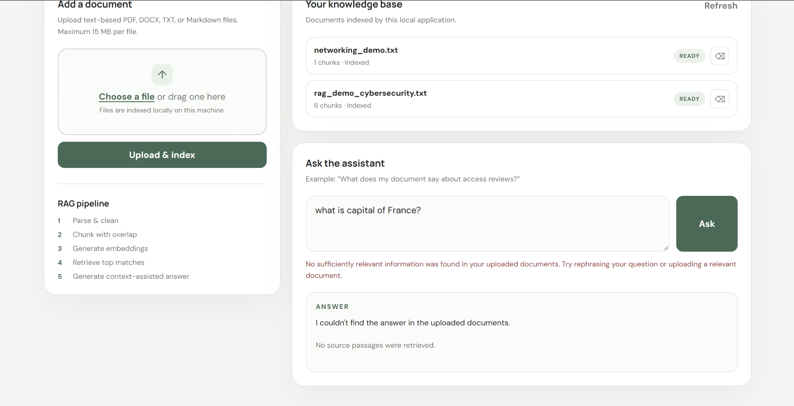

# AI Knowledge Assistant (RAG)

A local Retrieval-Augmented Generation (RAG) application that lets users upload documents, ask questions about their contents, and receive answers supported by retrieved passages.

The application is designed to answer from the documents in its local knowledge base—not from unrestricted internet search. When relevant information is unavailable, it should say so instead of inventing an answer.

## Screenshots

### Main interface


### Knowledge Base


### Retrieved sources


### Related question


### Upload errors


### Irrelevant question


## Features

- Upload up to five text-based PDF, DOCX, TXT, and Markdown documents at once (15 MB per file), with per-file results and partial-success reporting.
- Keep backward-compatible single-document upload API (`POST /documents`).
- Extract and clean document text.
- Split content into overlapping chunks.
- Generate embeddings with Sentence Transformers.
- Retrieve relevant passages using vector similarity.
- Generate context-assisted answers using a locally hosted Ollama model.
- Display retrieved source passages and relevance scores.
- Return an abstention response when the knowledge base does not contain relevant information.
- Delete indexed documents and refresh the knowledge-base view.
- Validate uploads and API inputs, and restrict the local frontend/backend configuration.

## Technology stack

- **Frontend:** HTML, CSS, JavaScript
- **Backend:** Python, FastAPI
- **Embeddings:** Sentence Transformers (`all-MiniLM-L6-v2`)
- **Vector storage:** Local NumPy-based index
- **LLM runtime:** Ollama
- **Default chat model:** `qwen2.5:3b`

## Requirements

- Python 3.10 or newer (use a Python version supported by the installed PyTorch and Sentence Transformers packages).
- [Ollama](https://ollama.com/) installed and running.
- Git.
- Internet access for the initial Python package and model downloads. After dependencies and models are downloaded, inference can run locally.

## Setup

### 1. Clone the repository

```bash
git clone https://github.com/Mansi422-dot/ai-knowledge-assistant-rag.git
cd ai-knowledge-assistant-rag
```

### 2. Create and activate a virtual environment

Linux / WSL / macOS:

```bash
python3 -m venv .venv
source .venv/bin/activate
python -m pip install --upgrade pip
python -m pip install -r requirements.txt
```

Windows PowerShell:

```powershell
py -m venv .venv
.venv\\Scripts\\Activate.ps1
python -m pip install --upgrade pip
python -m pip install -r requirements.txt
```

### 3. Configure environment variables

Copy the example configuration:

```bash
cp .env.example .env
```

Review `.env` and adjust values if needed. Do not commit `.env`; it may contain local configuration.

### 4. Start Ollama and download the model

Ensure the Ollama service is running, then:

```bash
ollama pull qwen2.5:3b
ollama list
```

The default configuration expects Ollama at `http://localhost:11434`.

### 5. Start the backend

From the repository root, with the virtual environment activated:

```bash
python -m uvicorn app.main:app --host 127.0.0.1 --port 8000
```

Backend API: `http://127.0.0.1:8000`

Health endpoint: `http://127.0.0.1:8000/health/live`

### 6. Start the frontend

Open a second terminal:

```bash
cd ai-knowledge-assistant-rag
python3 -m http.server 5173 --bind 127.0.0.1 --directory frontend
```

Open `http://127.0.0.1:5173/` in your browser.

The frontend is served from the dedicated `frontend/` directory rather than the repository root.

## Configuration

The example `.env.example` contains the following settings:

| Variable | Purpose |
|---|---|
| `LLM_MODEL` | Ollama chat model name |
| `LLM_BASE_URL` | Ollama service URL |
| `EMBEDDING_MODEL` | Sentence Transformers embedding model |
| `DATA_DIR` | Local directory for the index and uploaded documents |
| `MAX_UPLOAD_MB` | Maximum upload size in MB |
| `CHUNK_SIZE` | Target chunk size |
| `CHUNK_OVERLAP` | Overlap between adjacent chunks |
| `TOP_K` | Maximum number of retrieved passages |
| `SIMILARITY_THRESHOLD` | Minimum similarity score for retrieval |

Use `.env.example` as the source of truth for the actual default values.

## How the RAG pipeline works

1. **Parse and clean:** Extract text from an uploaded document.
2. **Chunk with overlap:** Split the text into smaller passages while retaining context between chunks.
3. **Generate embeddings:** Convert each passage into a numerical vector.
4. **Retrieve top matches:** Compare the question embedding with indexed passage embeddings.
5. **Generate an answer:** Send the question and retrieved context to the local language model, then display the answer with source references.

## Running tests

Activate the project virtual environment, then run:

```bash
python -m pip check
python -m compileall -q app tests
python -m pytest -q
```

## API overview

| Method | Endpoint | Purpose |
|---|---|---|
| `GET` | `/health/live` | Liveness check |
| `GET` | `/documents` | List indexed documents |
| `POST` | `/documents` | Upload and index a document |
| `DELETE` | `/documents/{filename}` | Delete an indexed document |
| `POST` | `/ask` | Ask a question against the knowledge base |

For the exact request and response schemas, inspect the FastAPI routes and Pydantic schemas in `app/`.

## Repository structure

```text
ai-knowledge-assistant-rag/
├── app/
│   ├── config.py
│   ├── documents.py
│   ├── llm.py
│   ├── main.py
│   ├── schemas.py
│   └── vector_store.py
├── data/
├── frontend/
│   └── index.html
├── screenshots/
│   ├── main-interface.png
│   ├── knowledge-base.png
│   ├── retrieved-sources.png
│   └── unrelated-question.png
├── tests/
│   ├── test_api.py
│   ├── test_config.py
│   ├── test_documents.py
│   ├── test_llm.py
│   ├── test_schemas.py
│   └── test_vector_store.py
├── .env.example
├── .gitignore
├── README.md
├── requirements.txt
├── networking_demo.txt
└── rag_demo_cybersecurity.txt
```

## Batch upload API

`POST /documents/batch` accepts multipart form data with repeated `files` fields (1–5 files, up to 15 MB each). It returns HTTP 200 with `total`, `successful`, `failed`, and per-file `results` (`indexed`, `duplicate`, or `failed`). Individual failures do not prevent other files from being indexed. The existing `POST /documents` single-file endpoint remains available.

## Local data and backups

The ZIP release intentionally omits runtime `data/index.json` and uploaded `data/*.txt` documents. **Keep your existing `data/` folder when updating an existing installation** to preserve your knowledge base. Never replace your working `data/` folder with the empty folder from a release ZIP.

## Security and limitations

- This is a **local, single-user project**, not a production-ready multi-user service.
- Run the backend bound to `127.0.0.1`; do not expose it directly to an untrusted network.
- The application does not provide user authentication, authorization, per-user document isolation, or production-grade rate limiting.
- Uploaded files are validated, but this project does not provide comprehensive malware scanning.
- The local JSON/NumPy index is intended for a single application process; do not run multiple Uvicorn workers against the same data directory.
- Retrieved passages provide traceability, not proof that an answer is correct.
- A `grounded` response indicates that retrieved document context was used; it does not mean the generated answer has been independently fact-checked.
- Prompt-injection handling is defensive, but no prompt-based system can guarantee immunity to malicious document content.

## Future improvements

- Improve retrieval quality with hybrid search and/or a reranker.
- Add evaluation datasets and retrieval/answer-quality metrics.
- Add stronger isolation and authentication before any network-facing deployment.
- Add more robust document-processing limits and operational monitoring.

## License

Add a license file if you intend to distribute this project under a specific open-source license.
