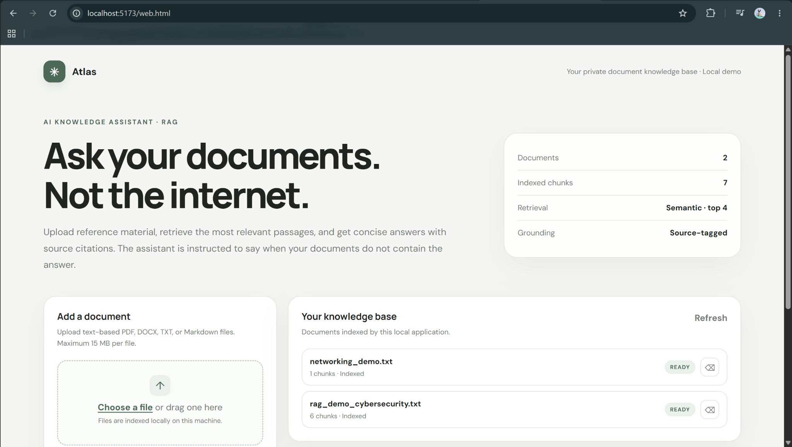
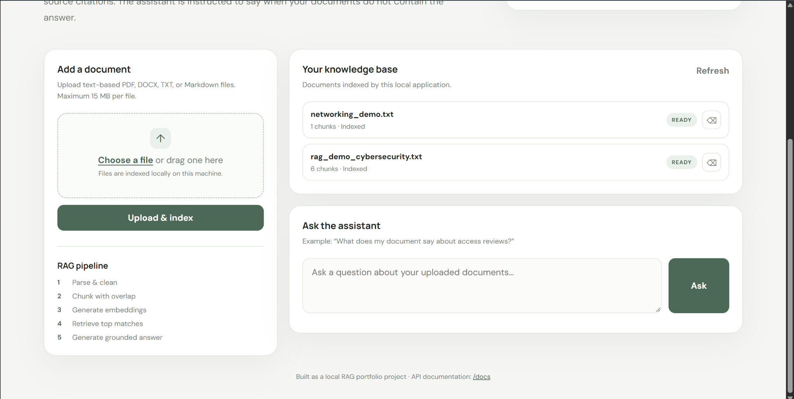
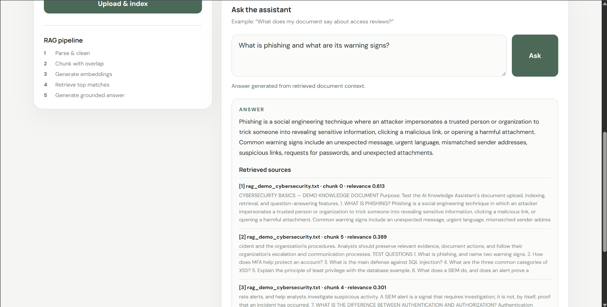
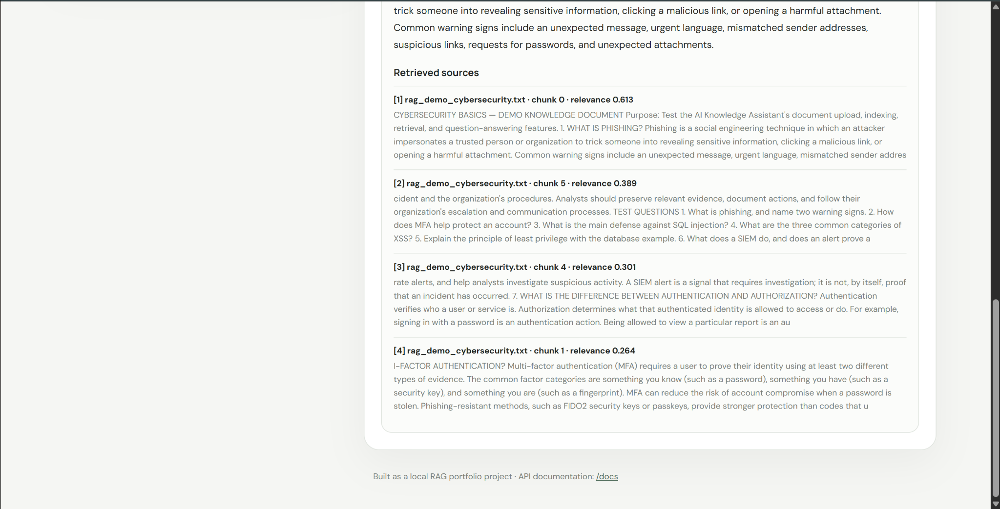
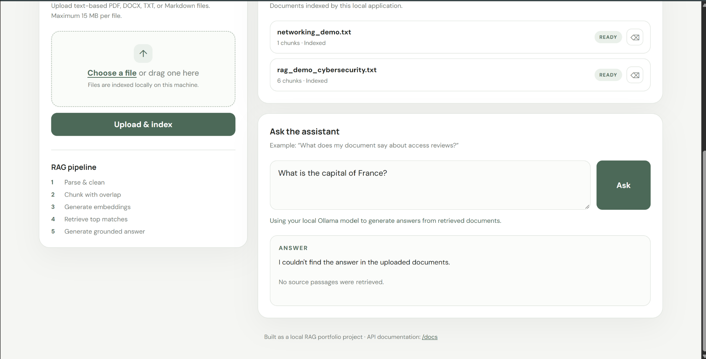

# AI Knowledge Assistant with RAG

A local AI-powered document question-answering assistant built using **Retrieval-Augmented Generation (RAG)**.

The application allows users to upload documents, extract and chunk their content, generate semantic embeddings, retrieve relevant passages, and generate grounded answers using a locally hosted **Ollama LLM**.

The assistant is designed to answer questions using only information contained in the uploaded documents. When relevant information cannot be found, it refuses to answer instead of inventing information.

> **Local-first:** The current version uses Ollama and the `qwen2.5:3b` model locally. No paid LLM API is required.

## Screenshots

### Main Interface



### Knowledge Base



### Grounded Answer



### Retrieved Sources



### Unrelated Question Rejection



## Features

- Upload PDF, DOCX, TXT, and Markdown documents
- Automatic document parsing and text extraction
- Text chunking with overlapping context
- Local semantic embeddings using Sentence Transformers
- Cosine-similarity based semantic search
- Configurable similarity threshold for relevance filtering
- Top-k document retrieval
- Grounded answer generation using a local Ollama LLM
- Source citations linked to retrieved document chunks
- Relevance scores for retrieved passages
- Multiple-document question answering
- Persistent local document index
- Upload, list, and delete indexed documents
- Rejects unrelated questions when relevant document context is unavailable
- FastAPI backend with interactive API documentation
- Browser-based frontend
- No paid LLM API required

## How It Works

The application follows a Retrieval-Augmented Generation pipeline:

```text
                ┌──────────────────┐
                │  Upload Document │
                └────────┬─────────┘
                         │
                         ▼
                ┌──────────────────┐
                │ Parse & Clean    │
                └────────┬─────────┘
                         │
                         ▼
                ┌──────────────────┐
                │ Text Chunking    │
                │ + Overlap        │
                └────────┬─────────┘
                         │
                         ▼
                ┌──────────────────┐
                │ Generate         │
                │ Embeddings       │
                └────────┬─────────┘
                         │
                         ▼
                ┌──────────────────┐
                │ Persistent       │
                │ Vector Index     │
                └──────────────────┘


User Question
      │
      ▼
┌──────────────────┐
│ Generate Query   │
│ Embedding        │
└────────┬─────────┘
         │
         ▼
┌──────────────────┐
│ Semantic Search  │
│ + Similarity     │
│ Threshold        │
└────────┬─────────┘
         │
         ▼
┌──────────────────┐
│ Relevant         │
│ Document Chunks  │
└────────┬─────────┘
         │
         ▼
┌──────────────────┐
│ Local Ollama LLM │
│ Qwen2.5 3B       │
└────────┬─────────┘
         │
         ▼
┌──────────────────┐
│ Grounded Answer  │
│ + Sources        │
└──────────────────┘
```

## Technology Stack

### Backend

- Python
- FastAPI
- Uvicorn
- Pydantic Settings
- HTTPX

### RAG / AI

- Sentence Transformers
- `sentence-transformers/all-MiniLM-L6-v2` embeddings
- Ollama
- `qwen2.5:3b`
- Cosine similarity
- Persistent JSON-based vector index

### Document Processing

- PyPDF
- `python-docx`
- TXT
- Markdown

### Frontend

- HTML
- CSS
- JavaScript

### Testing

- Pytest

## Project Structure

```text
AI_Knowledge_Assistant/
│
├── app/
│   ├── __init__.py
│   ├── config.py
│   ├── documents.py
│   ├── llm.py
│   ├── main.py
│   ├── schemas.py
│   └── vector_store.py
│
├── data/
│   └── .gitkeep
│
├── tests/
│   └── test_documents.py
│
├── screenshots/
│   ├── main-interface.png
│   ├── knowledge-base.png
│   ├── grounded-answer.png
│   ├── retrieved-sources.png
│   └── unrelated-question.png
│
├── web.html
├── requirements.txt
├── .env.example
├── .gitignore
└── README.md
```

The `data/` directory is used for the locally generated document index and uploaded documents.

Generated data is excluded from Git using `.gitignore`.

## Requirements

- Python 3.10+
- Ollama
- Qwen2.5 3B model
- Internet connection during the first embedding-model download

The application itself does not require a paid LLM API.

## Ollama Setup

Install Ollama on your system and download the model:

```bash
ollama pull qwen2.5:3b
```

Check that the model is available:

```bash
ollama list
```

Make sure Ollama is running before using the question-answering functionality.

On systems using the Ollama service:

```bash
sudo systemctl start ollama
```

Check its status:

```bash
sudo systemctl status ollama
```

The application communicates with Ollama through:

```text
http://localhost:11434
```

## Installation

Clone the repository:

```bash
git clone <YOUR_GITHUB_REPOSITORY_URL>
cd AI_Knowledge_Assistant
```

### Create a virtual environment

#### Linux / macOS / WSL

```bash
python3 -m venv venv
source venv/bin/activate
```

#### Windows

```powershell
python -m venv venv
venv\Scripts\Activate.ps1
```

Install dependencies:

```bash
pip install -r requirements.txt
```

Create the environment file if needed:

#### Linux / macOS / WSL

```bash
cp .env.example .env
```

#### Windows PowerShell

```powershell
Copy-Item .env.example .env
```

No paid LLM API key is required.

## Running the Application

### 1. Start Ollama

Make sure Ollama is running:

```bash
ollama list
```

If necessary:

```bash
sudo systemctl start ollama
```

### 2. Start the FastAPI backend

From the project directory:

```bash
source venv/bin/activate
python -m uvicorn app.main:app --reload
```

The backend runs at:

```text
http://localhost:8000
```

### 3. Start the frontend

Open another terminal in the project directory:

```bash
python3 -m http.server 5173
```

Then open:

```text
http://localhost:5173/web.html
```

## Using the Assistant

### Step 1 — Upload a document

Upload a supported:

- PDF
- DOCX
- TXT
- Markdown

The document is parsed, split into chunks, embedded, and added to the local index.

### Step 2 — Ask a question

Enter a question about the uploaded documents.

For example:

```text
What is phishing and what are its warning signs?
```

The application retrieves the most relevant document passages and sends them to the local Ollama model.

### Step 3 — Review the answer

The assistant displays:

- Generated answer
- Retrieved source documents
- Chunk numbers
- Relevance scores
- Source excerpts

The model is instructed to answer only from the retrieved document context.

## Relevance Filtering

The application uses a similarity threshold to reduce irrelevant retrievals.

Current configuration:

```python
top_k = 4
similarity_threshold = 0.25
```

Questions that do not produce sufficiently relevant document matches are rejected rather than answered from unrelated context.

For example, if the uploaded documents contain cybersecurity information and the user asks:

```text
What is the capital of France?
```

the assistant should respond that it could not find the answer in the uploaded documents.

## Local AI Architecture

The application uses two local AI components.

### Embedding Model

```text
sentence-transformers/all-MiniLM-L6-v2
```

This converts document chunks and user questions into numerical vector representations.

### Language Model

```text
qwen2.5:3b
```

The model runs locally through Ollama.

The application sends the retrieved document context to Ollama and asks it to generate an answer grounded in that context.

## API Endpoints

### Health Check

```http
GET /health
```

Returns the application and index status.

### Upload Document

```http
POST /documents
```

Accepts a multipart file upload.

### List Documents

```http
GET /documents
```

Returns the currently indexed documents.

### Delete Document

```http
DELETE /documents/{filename}
```

Removes a document and its associated chunks.

### Ask a Question

```http
POST /ask
```

Example request:

```json
{
  "question": "What is phishing?",
  "top_k": 4
}
```

### Interactive API Documentation

FastAPI provides interactive API documentation at:

```text
http://localhost:8000/docs
```

## Testing

Run the automated tests:

```bash
pytest
```

The project has also been manually tested for:

- Document upload
- Document indexing
- Semantic retrieval
- Grounded answer generation
- Source citation
- Unrelated-question rejection
- Multiple-document retrieval
- Persistence after backend restart
- Local Ollama integration

## Configuration

The main configuration is located in:

```text
app/config.py
```

Current defaults include:

```text
LLM Model:
qwen2.5:3b

Ollama:
http://localhost:11434

Embedding Model:
sentence-transformers/all-MiniLM-L6-v2

Maximum Upload Size:
15 MB

Chunk Size:
900

Chunk Overlap:
150

Top K:
4

Similarity Threshold:
0.25
```

## Security Considerations

This project is intended as a local demonstration and learning project.

It should not be exposed directly to the public internet without additional security controls.

The current application does not implement:

- User authentication
- Authorization
- Per-user document isolation
- Rate limiting
- Malware scanning
- Production-grade vector database security
- Multi-user concurrency controls

Do not upload sensitive or confidential documents unless you understand the risks of storing them locally.

## Limitations

- Scanned PDFs require OCR and may not produce usable text.
- The vector index is JSON-based and intended for a local/single-user application.
- Local LLM response quality depends on the selected model.
- Retrieval quality depends on document content, chunking, embeddings, and similarity threshold.
- RAG reduces unsupported answers but does not guarantee factual accuracy.
- The application is designed to run locally and is not currently deployed as a public service.

## Future Improvements

Potential future improvements include:

- OCR support for scanned documents
- Authentication and authorization
- Streaming LLM responses
- Better document management
- Conversation history
- Metadata filtering
- Hybrid keyword + semantic search
- Vector database integration
- Multi-user support
- Docker deployment
- Additional local LLM models
- Automated integration testing

## License

This project is intended for educational and portfolio purposes.
